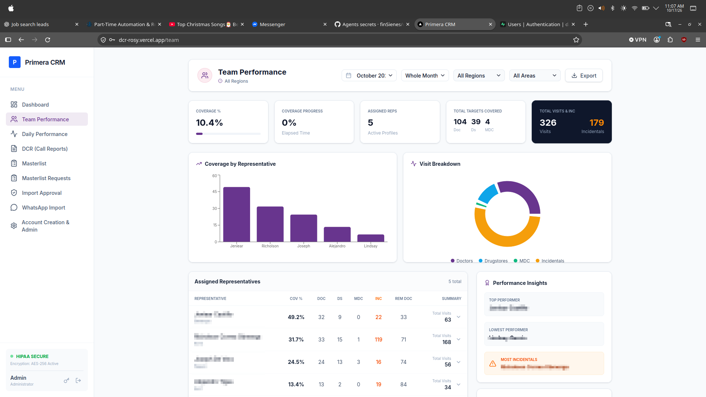
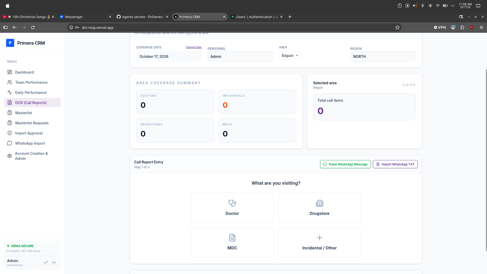
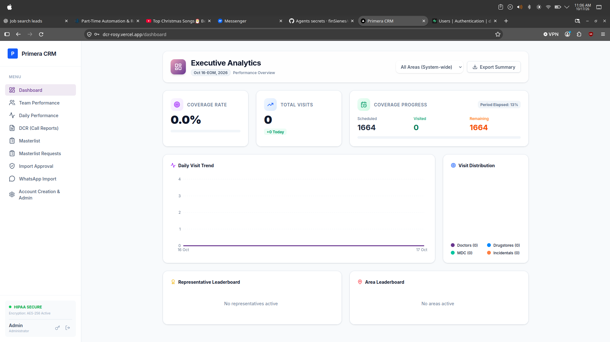
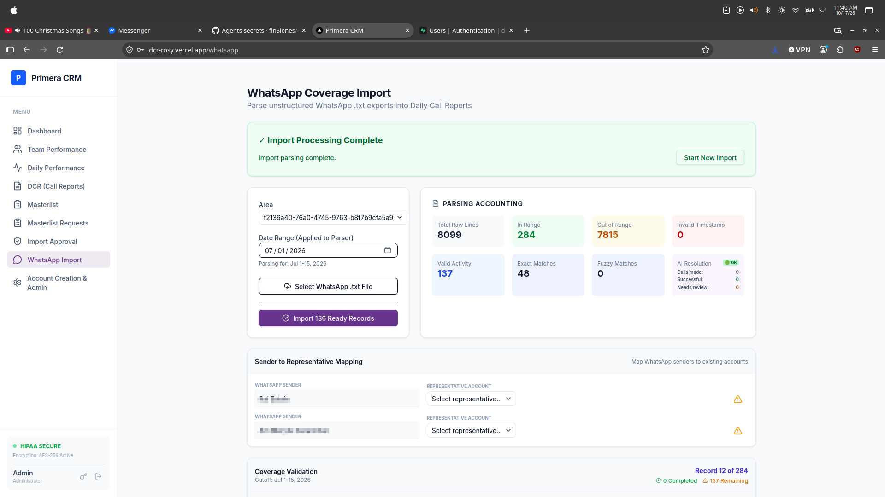
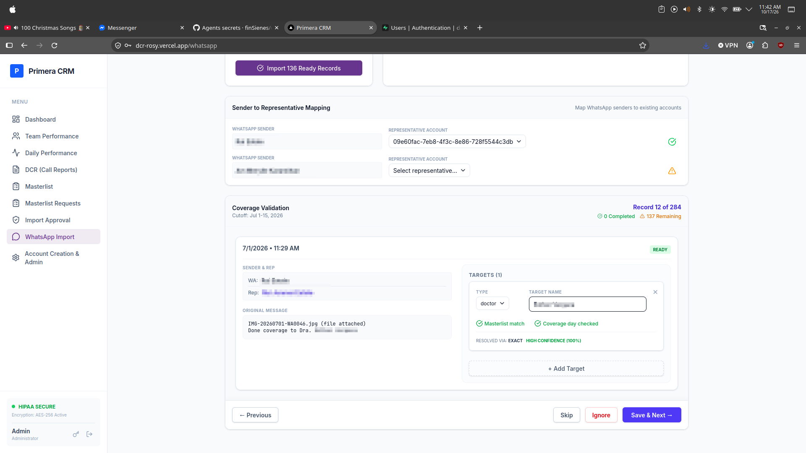
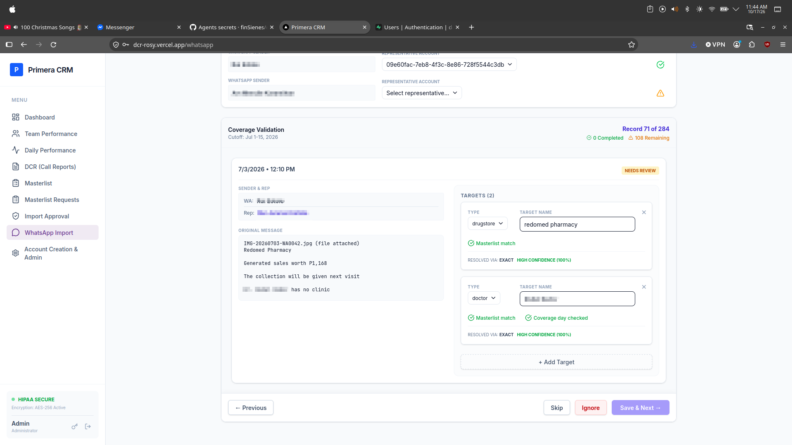
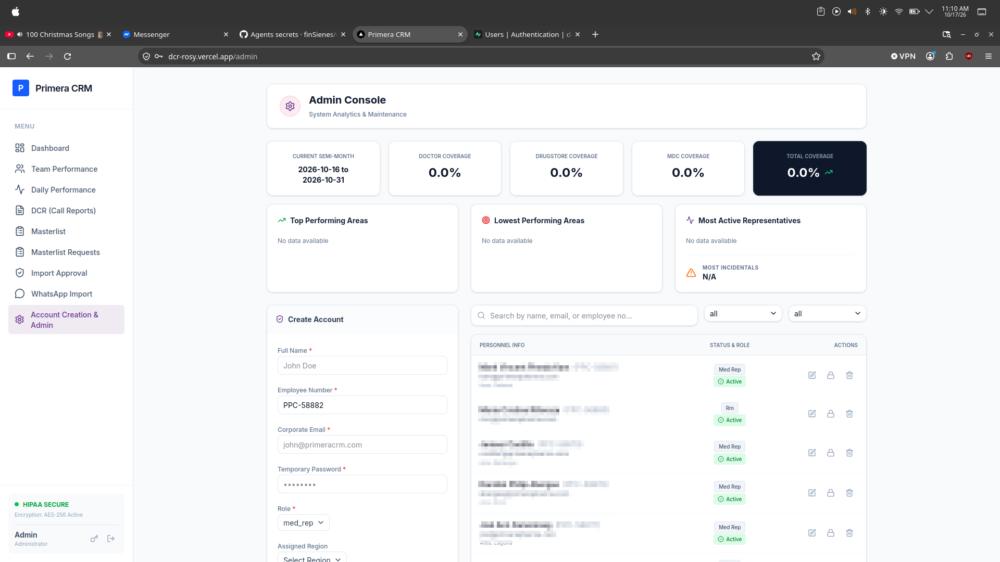

# Daily Coverage Reporting System (DCR)

**Status:** Functional MVP — Ongoing Development

A web-based application designed to simplify daily field coverage reporting, automate coverage calculations, and help management monitor representative performance.

## Project Overview

This project explores replacing manual reporting processes with a centralized digital workflow.

The application supports Daily Call Report (DCR) entry, coverage monitoring, performance analytics, and importing historical reports from WhatsApp conversations.

## Implemented Features

- Daily Call Report entry for doctors, drugstores, MDCs, and incidental activities
- Automatic coverage calculations and representative performance summaries
- Regional and area-based reporting dashboards
- National masterlist management
- WhatsApp TXT import with activity extraction, masterlist matching, and manual validation
- Role-based workflows and account administration
- CSV import and report export functionality

## Development and Testing

The core reporting workflow is functional and has been manually tested using different user roles and reporting scenarios.

The project was developed with AI-assisted coding tools, with my involvement in workflow planning, requirements definition, testing, troubleshooting, and iterative improvements.

## Current Limitations

- Real-time synchronization between active users is not yet implemented
- Further security and multi-user testing is required
- Some interface improvements remain
- Additional business modules are outside the current MVP scope

## Portfolio Note

This repository is a documentation-only case study. The application source code and operational database are not publicly available. Any future demonstrations will use fictional data and a separate environment.

## Application Screenshots

### Team Performance
Automated coverage calculations and representative performance monitoring.

### Daily Coverage Report Entry
Structured daily call reporting for doctors, drugstores, MDCs, and incidental activities.

### Executive Analytics
Coverage statistics and management reporting.

### WhatsApp Import
Import and analyze WhatsApp chat exports before validating coverage activities.

### WhatsApp Validation
Review extracted activities and match them against masterlist records.

### Multiple Target Recognition
Review multiple coverage targets identified within one WhatsApp message.

### Account Administration
User account and role management interface.

