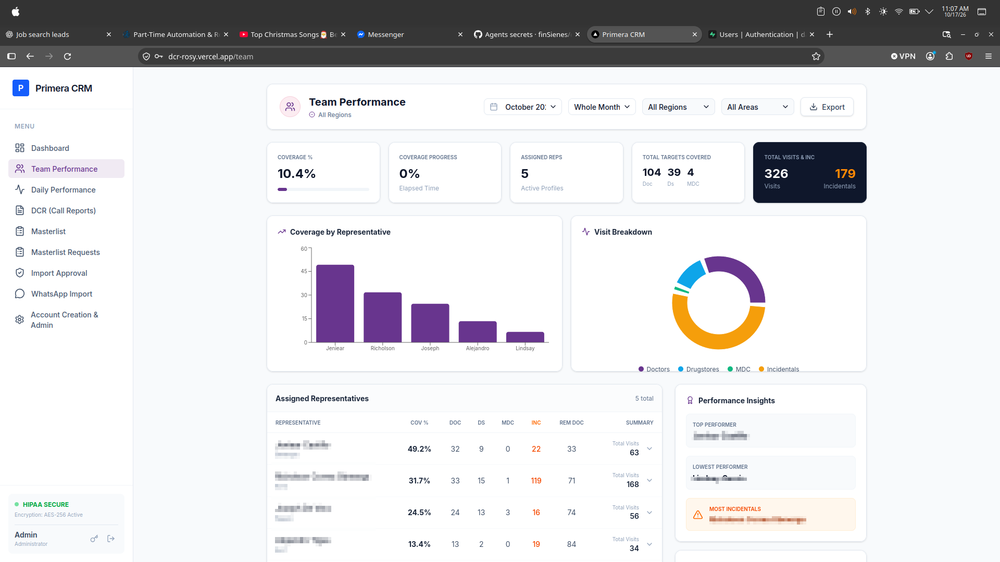
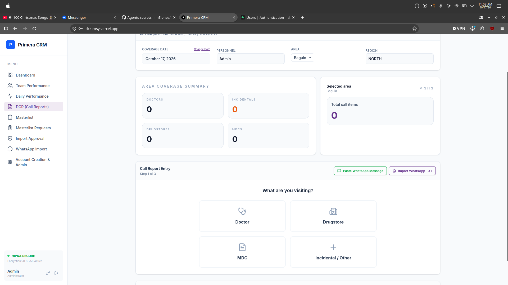
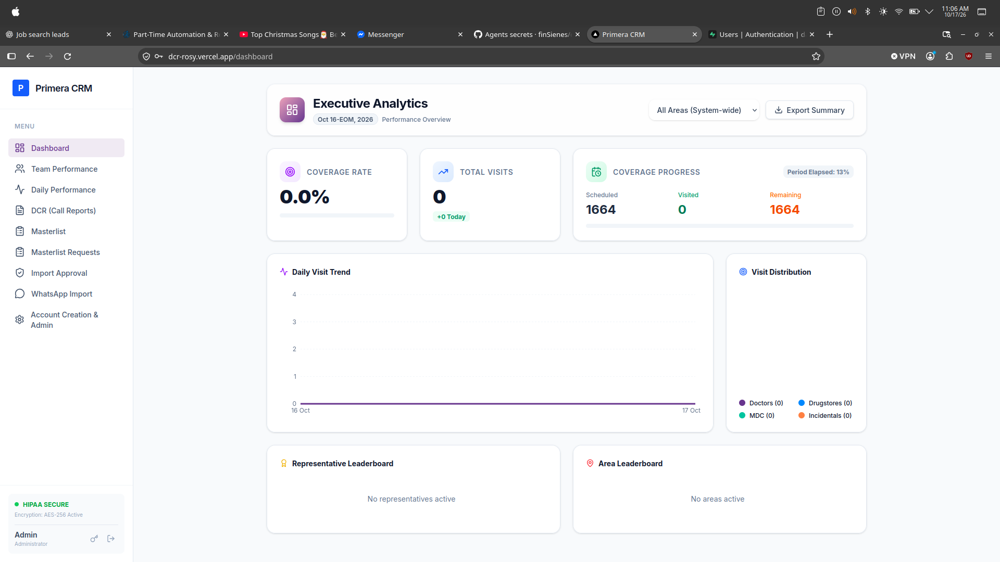
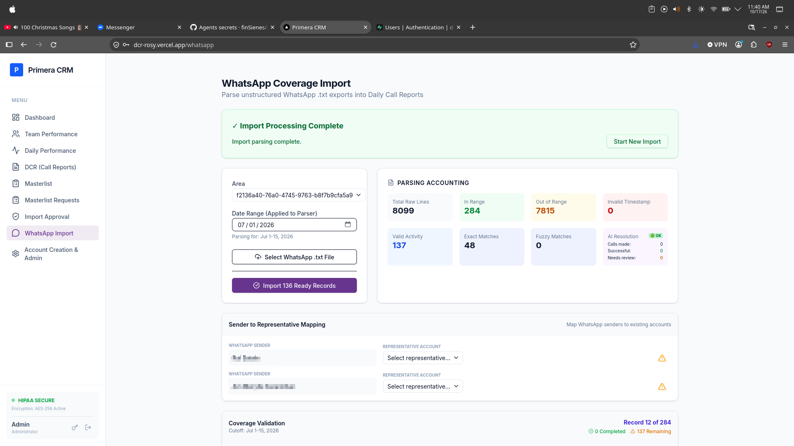
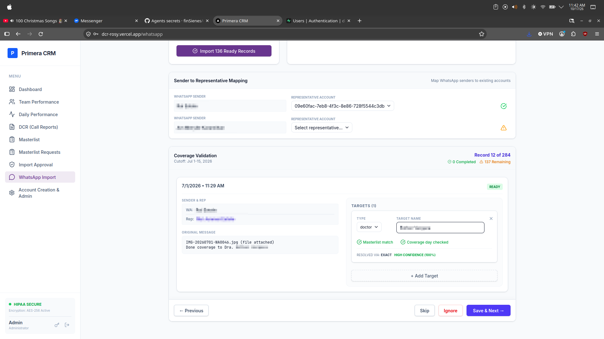
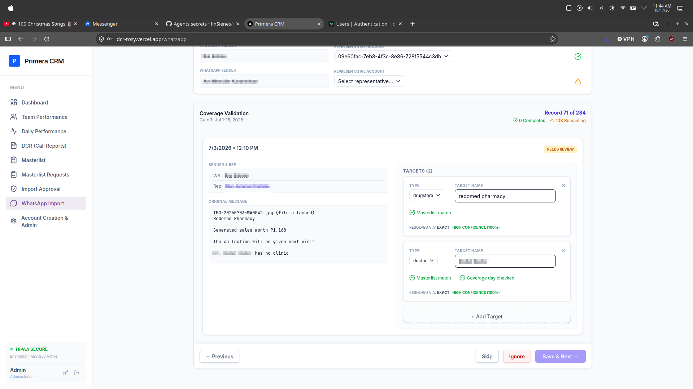
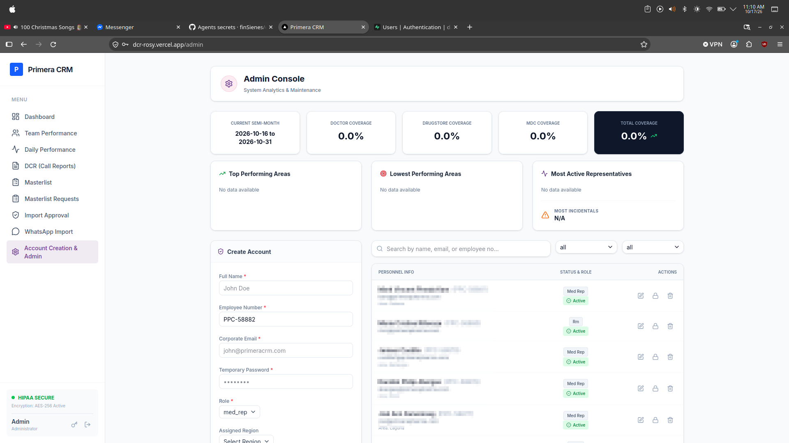

# Daily Coverage Reporting System (DCR)

**Status:** Functional MVP, ongoing development

A web app that replaced a slow, manual field-reporting process with one validated, searchable workflow: daily call report entry, automatic coverage calculations, and cleaned imports of historical data.

## At a Glance

| | |
|---|---|
| **Problem** | Field coverage reports were compiled by hand from Excel files and WhatsApp messages, which took about five days and invited errors, omissions, and duplicates. |
| **Solution** | A web app for structured report entry, automatic coverage calculations, and validated WhatsApp/CSV imports matched against a national masterlist. |
| **Result** | Reduced manual compilation from about five days to one or two. Merged 11,800+ historical records with newer app data, reviewed duplicate groups, and checked the merged data for missing fields. |
| **Stack** | Supabase (database), [add your frontend, hosting, and any other tools] |
| **My role** | Requirements, workflow design, data cleaning and validation, testing, and troubleshooting, with AI-assisted coding. |

## Project Overview

This project replaces manual reporting with a centralized digital workflow. It supports Daily Call Report (DCR) entry, coverage monitoring, performance analytics, and importing historical reports from WhatsApp conversations.

## Data Quality Work

Much of the value came from getting the data right, not only building screens:

- Merged an older import of 11,800+ records with the working app's later records, so reports cover the full period.
- Cleaned inconsistent names (for example, removing title prefixes) and mapped records to the correct areas, including areas shared between teams.
- Reviewed groups of duplicate records, with up to three copies of the same entry, before finalizing.
- Validated the merged data for missing fields.
- Added manual validation to the WhatsApp import, so extracted activities are reviewed and matched to masterlist records before they count.

## Implemented Features

- Daily Call Report entry for doctors, drugstores, MDCs, and incidental activities
- Automatic coverage calculations and representative performance summaries
- Regional and area-based reporting dashboards
- National masterlist management
- WhatsApp TXT import with activity extraction, masterlist matching, and manual validation
- Role-based workflows and account administration
- CSV import and report export

## Development and Testing

The core reporting workflow is functional and has been manually tested with different user roles and reporting scenarios.

The project was developed with AI-assisted coding tools. My involvement covered workflow planning, requirements definition, data validation, testing, troubleshooting, and iterative improvements.

## Current Limitations

- Real-time synchronization between active users is not yet implemented
- Further security and multi-user testing is required
- Some interface improvements remain
- Additional business modules are outside the current MVP scope

## Portfolio Note

This repository is a documentation-only case study. The application source code and operational database are not publicly available. Any future demonstrations will use fictional data and a separate environment.

## Application Screenshots

### Team Performance

Automated coverage calculations and representative performance monitoring.

### Daily Coverage Report Entry

Structured daily call reporting for doctors, drugstores, MDCs, and incidental activities.

### Executive Analytics

Coverage statistics and management reporting.

### WhatsApp Import

Import and analyze WhatsApp chat exports before validating coverage activities.

### WhatsApp Validation

Review extracted activities and match them against masterlist records.

### Multiple Target Recognition

Review multiple coverage targets identified within one WhatsApp message.

### Account Administration

User account and role management interface.

